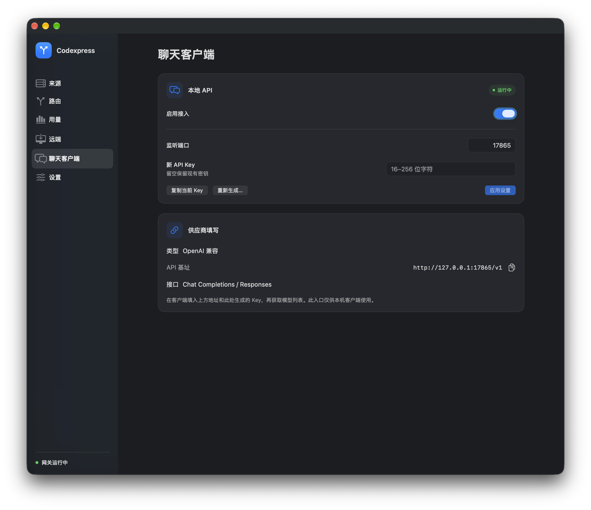

<p align="center">
  
</p>
<h1 align="center">Codexpress</h1>
<p align="center">一个管理 Codex 账号、API 和用量的 Mac 菜单栏小工具。</p>
<p align="center">
  
  
</p>
<p align="center">
  <a href="#安装">安装</a> ·
  <a href="#开始使用">开始使用</a> ·
  <a href="docs/usage.md">使用指南</a>
</p>

<p align="center">
  
  <br><sub>用量概览，图中为演示数据</sub>
</p>

## 功能

- 将 ChatGPT 账号和第三方 API 放入同一个来源池，按优先级自动切换。
- 为每个来源选择直连或本地代理，官方登录与来源池模式一键切换。
- 在菜单栏查看官方额度、周限量和供应商余额，设置余额不足提醒。
- 按来源、模型查看 Token 用量、参考费用、输出速度和请求记录。
- 自动获取模型列表，为不同模型设置上下文压缩阈值。
- 通过 SSH 将远端 Codex 接入本机来源池，支持配置备份与还原。
- 为聊天客户端提供独立的 OpenAI 兼容接口和模型列表。

<details>
<summary>更多界面</summary>
<br>
<table>
  <tr>
    <td width="50%" align="center"><br><sub>来源管理</sub></td>
    <td width="50%" align="center"><br><sub>聊天客户端</sub></td>
  </tr>
</table>
<p align="center">
  
  <br><sub>模型压缩设置</sub>
</p>
<p align="center">
  
  <br><sub>菜单栏面板</sub>
</p>
</details>

## 安装

支持 Apple Silicon Mac，要求 macOS 14 或更新版本。目前从源码构建，需要安装 Xcode 和 Rust stable。

```sh
git clone https://github.com/LEOibyug/Codexpress.git
cd Codexpress
bash scripts/build.sh
```

将生成的 `dist/Codexpress.app` 拖入「应用程序」后打开。当前构建使用本地签名，尚未经过 Apple 公证。

## 开始使用

1. 在「来源」添加 ChatGPT 账号或第三方 API，按需填写本地代理端口。
2. 调整来源优先级。
3. 在「设置」预览并应用连接设置。应用会备份原配置与认证文件，然后重启 Codex。
4. 开始对话，在「用量」查看请求使用的来源和消耗。

来源池模式下需保持 Codexpress 运行。停用前可在设置中恢复原连接；需要使用 Codex 原生官方功能时，可切换到「直接官方登录」。

接入其他聊天软件时，在「聊天客户端」复制地址和 Key，按 OpenAI 兼容供应商填写即可。

代理设置、旧对话接续、SSH 接入和备份还原等操作见 [使用指南](docs/usage.md)。

## 开发

界面使用 SwiftUI / AppKit，内置网关使用 Rust。

```sh
bash scripts/check.sh  # Rust 检查与测试
swift test            # Swift 测试
bash scripts/build.sh # 构建 macOS 应用
```

## 致谢

感谢 [CodexBar](https://github.com/lizhelang/codexbar)、[CC Switch](https://github.com/farion1231/cc-switch)、[One API](https://github.com/songquanpeng/one-api) 和 [New API](https://github.com/QuantumNous/new-api) 带来的参考与启发。

随应用分发的第三方资源及许可证见 [资源说明](gateway/resources/README.md)。
