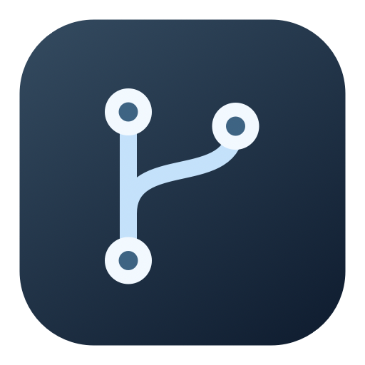
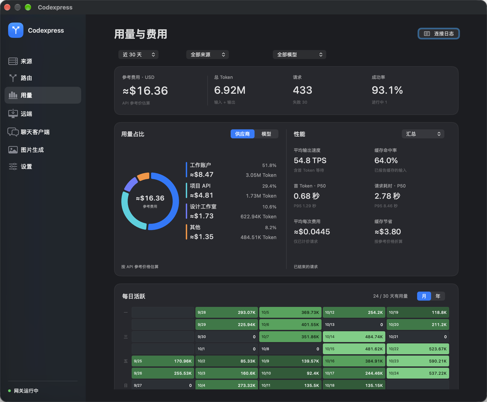
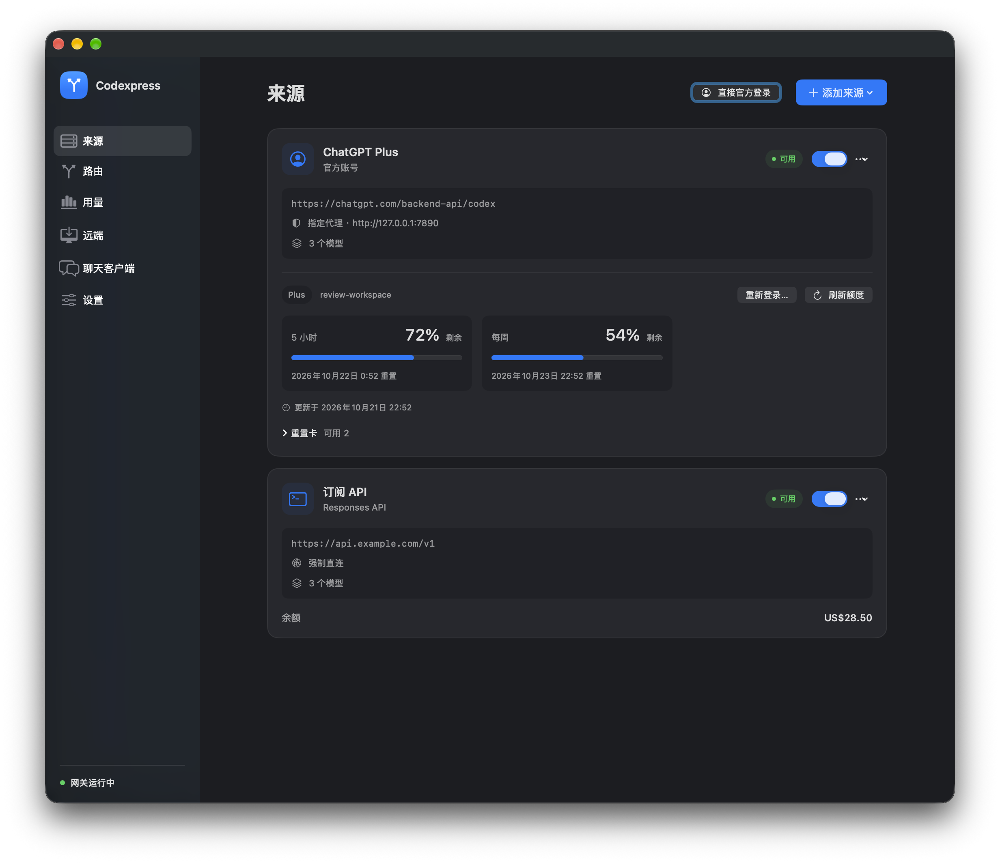
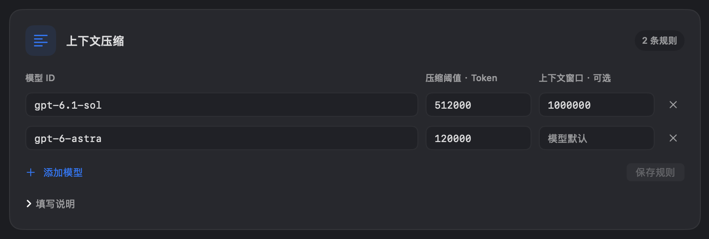
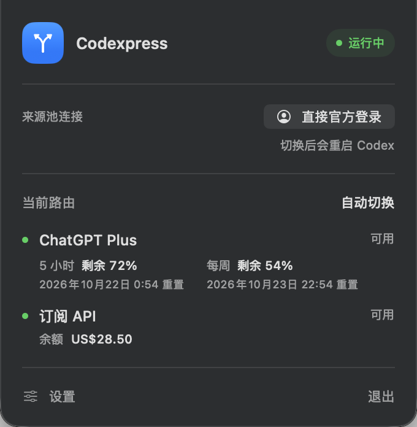

<p align="center">
  
</p>
<h1 align="center">Codexpress</h1>
<p align="center"><strong>在 Mac 菜单栏管理 Codex 的账号、API 与用量。</strong></p>
<p align="center">官方与第三方来源共用优先级池，逐源设置网络，连续对话保持来源。</p>
<p align="center">
  
  
  
</p>
<p align="center">
  <a href="#快速开始">快速开始</a> ·
  <a href="#主要功能">主要功能</a> ·
  <a href="docs/usage.md">使用指南</a> ·
  <a href="#开发与验证">开发与验证</a>
</p>

<p align="center">
  
  <br><sub>用量概览 · 截图中的账号与统计为演示数据</sub>
</p>

## 主要功能

| | 能做什么 |
| :-- | :-- |
| **统一来源池** | 官方 ChatGPT 账号与第三方 Responses API 按优先级使用，也可固定来源。 |
| **独立网络策略** | API 默认强制直连；官方来源只需填写本地代理端口。指定代理不可用时不会改为直连。 |
| **连续对话** | 优先沿用已成功连接的来源，迁移后保持新来源，减少切换带来的缓存损失。 |
| **本地原文缓存** | 压缩去重保存输入和回复，默认最多 5 GB，按增量块的最近使用时间淘汰。 |
| **SSH 远端接入** | 探测远端 Codex 目录与本机地址，备份后切到本机来源池，支持还原和撤销远端 Key。 |
| **官方余量保护** | 展示短周期与周额度；默认剩余 ≤ 10% 时为活跃对话保留余量，归零后跳过。 |
| **实时用量** | 按来源查看请求、输入／输出、缓存与推理 Token，以及 TPS、首 Token 延迟和成功率。 |
| **逐模型压缩** | 为不同模型设置自动压缩阈值及上下文窗口，自动获取供应商模型列表。 |
| **原生官方登录** | 一键切换到 Codex 自己的官方登录并重启，支持返回来源池。 |
| **备份与恢复** | 应用连接前备份配置和文件认证，支持一键还原；手动使用官方重置卡。 |

<details>
<summary><strong>查看更多界面</strong> · 来源、模型规则与菜单栏</summary>
<br>
<table>
  <tr>
    <td width="50%" align="center"><br><sub>来源与网络策略</sub></td>
    <td width="50%" align="center"><br><sub>模型压缩规则</sub></td>
  </tr>
</table>
<p align="center">
  
  <br><sub>菜单栏中的官方余量</sub>
</p>
</details>

## 快速开始

需要 **Apple Silicon Mac、macOS 14+、Xcode／Swift 和 Rust stable**。当前提供源码构建，应用使用 ad-hoc 签名，尚未 Apple 公证。

```sh
git clone https://github.com/LEOibyug/Codexpress.git
cd Codexpress
bash scripts/build.sh
```

将生成的 `dist/Codexpress.app` 拖到 `/Applications`，打开应用。请保持 `.app` 完整，网关随应用一起分发。

1. **添加来源**：填写 API 地址和密钥；官方账号填写本地 Clash HTTP／混合代理端口，例如 `7890`，再登录。
2. **调整路由**：为来源排序，设置官方余量阈值，或选择固定来源。
3. **应用连接**：在「设置」核对 Codex 配置目录，预览后点击「应用连接设置」。应用会先备份配置与文件认证，再正常重启 Codex。
4. **确认请求**：在 Codex 发起对话，在「用量」查看当前请求及实际来源。

已有对话若保存了旧供应商 ID，可在连接预览中选择其原 API 来源，并确认使用同一账号和密钥。[旧对话接续说明 →](docs/usage.md#旧对话接续与最终兜底)

> 退出 Codexpress 会停止网关。需要停用时，先在设置中「恢复原连接」；Clash TUN／透明代理应保持关闭。

## 两种连接方式

| | 来源池 | 直接官方登录 |
| :-- | :-- | :-- |
| **请求路径** | Codex → 本地网关 → 所选来源 | Codex → 官方服务 |
| **账号认证** | Codexpress 管理各来源的认证 | Codex 自己的 ChatGPT 登录 |
| **网络** | 按来源强制直连或使用指定代理 | 系统网络与系统代理 |
| **路由与统计** | 优先级切换、逐源用量与速度统计 | 原生流量不计入网关统计 |
| **原生功能** | 取决于模型及上游接口 | Chat、绘图、网页会话等由客户端及账号提供 |

切换时会正常重启 Codex，并分别保留来源池和官方模式的文件认证。原生登录改写 `auth.json` 后，返回来源池可恢复原文件认证。[认证与备份说明 →](docs/usage.md#配置与认证备份)

## 连续对话如何处理

**新对话按优先级分配，已有对话优先留在原来源。** 官方任一主额度不高于默认阈值 10%，且同账号已有活跃对话时，不再接收新对话；额度归零则跳过。恢复后，新对话可以再次使用官方账号，已迁移对话保持新来源。

如果旧上下文无法续接，默认启用的最终兜底会尝试移除**本次上游请求副本**中的加密块与旧状态引用，保留可见历史和工具结果，再建立新上下文。隐藏推理或压缩摘要可能缺失，触发时会发送系统通知。本地对话记录不变，可在路由页关闭兜底。

官方额度耗尽也会通知一次。已开始输出或提交结果不明时，不自动重放请求。[完整接续与余量规则 →](docs/usage.md#连续对话与余量保护)

## 用量与数据

- **上游计数优先**：详细 `usage` 到达后替换估算；缺失时按可观察字符估算，以 `≈` 标记。缓存和推理计数只使用上游报告值。
- **实时刷新**：用量页每秒更新，可按来源和时间筛选。TPS 使用输出 Token 与生成时间计算，估算值不等于账单。
- **凭据存储可选**：默认使用 Codexpress 专属 macOS Keychain 项；可在「设置 → 凭据存储」迁移到 `~/.codexpress/credentials.json`。本地文件不加密，目录／文件权限为 0700／0600。[存储与迁移说明 →](docs/usage.md#凭据存储)
- **原文缓存可管理**：在「设置 → 本地原文缓存」开关采集、调整容量或清空。容量包含压缩内容与索引；淘汰按增量块进行，缺块时不会把不完整历史当作完整上下文重建。
- **统计与正文分开保存**：用量统计只保存数字元数据。原文缓存仅收集经过网关的输入、回复和工具交互，不保存认证头，不读取或改写 Codex 历史数据库。

应用数据位于 `~/Library/Application Support/Codexpress`。[数据与兼容边界 →](docs/usage.md#配置和数据)

## SSH 远端接入

在「远端」可从本地 `~/.ssh/config`（含 `Include`）选择主机，或手动填写服务器地址、用户名及可选端口、私钥文件。点击「连接并探测」后，应用会查找远端 `CODEX_HOME` 和用户目录下的 `.codex`，并尝试获取服务器看到的本机 IP；目录与 IP 均可手动填写。

开启远端入口（默认端口 `17864`），预览后「备份并应用」。应用会先从远端验证连通性，再备份配置与文件认证、写入网关 URL 和独立 Key。完成后重启远端 Codex；可在应用中还原上次备份或撤销该机器的 Key。

此入口仅支持来源池，使用 HTTP，适合**可信局域网或 VPN**。本机需保持运行、远端需 Python 3 与可用的 SSH 密钥登录。公网 NAT、跳板机或防火墙可能使探测 IP 不可达，需手动填写可达地址；当前不自动建立 SSH 隧道或配置端口映射。[完整说明 →](docs/usage.md#ssh-远端接入)

## 开发与验证

原生 SwiftUI／AppKit 菜单栏客户端，内置 Rust Responses 网关，默认仅监听本机，远端入口按需开启。支持原生 Responses HTTP／SSE，包含 `/responses`、`/responses/compact` 和 `/models`；当前不提供 Chat Completions 或 Anthropic 协议转换。

```sh
# 编译、Rust 测试及 Clippy
bash scripts/check.sh

# Swift 测试
swift test

# 生成并签名 arm64 应用
bash scripts/build.sh
```

<details>
<summary>隔离运行与真实 CLI 回归</summary>

通过 `CODEXPRESS_STATE_DIR` 指定独立状态目录，通过 `CODEXPRESS_GATEWAY_PATH` 指定 helper。使用较短的绝对路径，以满足 Unix socket 长度限制。

```sh
CODEXPRESS_STATE_DIR=/tmp/codexpress-dev bash scripts/run.sh

# 本地模拟上游，检查工具续接及详细 Token 采集
python3 scripts/check-gateway-continuation.py

# 先产生旧供应商加密上下文，再接入网关并重启续接
python3 scripts/check-legacy-resume.py
```

两个脚本都支持 `--codex /path/to/codex`。测试使用临时目录和 localhost 模拟服务，不消耗真实生成额度或重置卡。

</details>

## 文档与致谢

| 文档 | 内容 |
| :-- | :-- |
| [使用指南](docs/usage.md) | 模型发现、代理、压缩阈值、官方额度、重置卡、备份与兼容范围 |
| [第三方资源说明](gateway/resources/README.md) | 随应用分发的 Codex 模型资源及许可证 |

界面与工作流参考 [CodexBar](https://github.com/lizhelang/codexbar) 和 [CC Switch](https://github.com/farion1231/cc-switch)，来源池设计参考 [One API](https://github.com/songquanpeng/one-api) 与 [New API](https://github.com/QuantumNous/new-api)。
