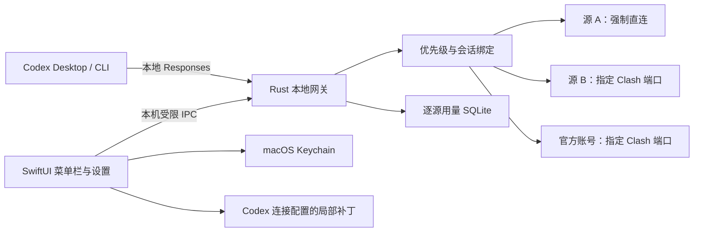

# Codexpress 定制设计草案

日期：2026-10-20。状态：用户已确认；首版已实现并完成本地验证。真实账号和具体 Codex Desktop 历史恢复仍需用户验收，详见 [验证记录](/Users/rhetoric/Work/Codexpress/docs/verification-2026-10-20.md)。

## 1. 产品目标与已确认范围

为 Apple Silicon Mac 制作轻量、原生风格的 Codex 菜单栏伴侣。Codex 连接本地网关；网关决定本次请求由哪一个官方 OAuth 账号或第三方 API 源处理，并按该源的网络策略出站。

已确认：官方账号和第三方 API 共同参与优先级消耗；只需覆盖系统代理，Clash TUN／增强模式保持关闭。

补充需求：官方源支持查看重置卡并由用户手动使用；不会因为额度耗尽或卡片即将过期而自动消耗。

首版以 Codex Desktop 为主要验收对象，同时测试 CLI。使用用户现有的 CODEX_HOME，不为每个源复制历史、工具或项目配置。

## 2. 可选实现路线

| 路线 | 收益 | 代价 | 判断 |
| --- | --- | --- | --- |
| 新建 SwiftUI 客户端 + Rust 网关 | 原生界面；网络和优先级规则集中；只实现需要的功能 | 需要自行集成 OAuth、配置补丁和服务生命周期 | 推荐 |
| 精简并改造 codexbar | 可较快继承菜单栏、OAuth、额度与已有网关 | 需要拆除多工具业务并统一分散的网络路径；现有官方网关会重写请求体 | 备选 |
| 从 CC Switch 派生 | 网关与配置管理已有大量可参考实现 | 原有 Tauri 界面和多协议功能范围较大；原生 Mac 界面需另做 | 不作为首选 |

默认推荐第一条。只移植必要且已经理解的代码；实质性复用时保留 MIT 归属。

## 3. 总体结构

- SwiftUI／AppKit：菜单栏面板、源管理、优先级排序、代理设置、额度、统计和连接配置预览。
- Rust／Tokio／HTTP 库：环回监听、流式转发、逐源网络客户端、官方认证请求、额度查询、路由和统计。
- TOML 编辑采用保留注释与布局的补丁机制。
- UI 和网关通过用户专属 Unix socket 通信，目录权限 0700、socket 权限 0600；不开放公网管理接口。
- 上游 API key 和 OAuth 凭据由 Keychain 保存。网关获得运行时所需凭据，日志不记录凭据或对话内容。

所有由应用发出的上游网络请求统一经过网关的客户端工厂。SwiftUI 不另用共享 URLSession 查询官方信息，避免代理规则出现两套实现。

## 4. 界面

常驻菜单栏，一个短面板展示：服务运行状态、自动池／固定源、当前源、网络策略、官方剩余额度、可用重置卡和今日用量。

独立设置窗口只分四页：

1. **来源**：添加官方账号或 API；显示地址、是否启用、支持的模型、直连／指定代理状态；官方账号可展开重置卡列表并手动使用。
2. **路由**：拖拽排序、自动优先级池、固定某个源、冷却和耗尽原因。
3. **用量**：按来源与日期查看 Token、请求、失败、延迟；有单价才显示费用估算。
4. **设置**：本地端口、Codex 路径、连接配置预览、恢复受管字段、登录启动。

采用系统字体、SF Symbols、系统浅深色和原生材质。首版不引入多 AI 软件管理、云同步、会话编辑器或完整聊天 UI。

## 5. 配置与历史保留

### 5.1 不变式

- 不切换、复制或重建用户的 CODEX_HOME。
- 不写入 sessions、archived_sessions 或 Codex 状态数据库，不修改历史会话的 provider 元数据。
- 不改写 MCP、skills、plugins、hooks、AGENTS、权限、项目、模型目录及用户维护的其他配置。
- 切换实际源和修改优先级只更新网关状态，不反复重写 Codex 配置。
- 网关官方账号与 Codex 原生登录分开管理；不能用第三方 API key 覆盖原生 OAuth。

### 5.2 首次接管

先启动网关并通过健康检查，再预览和写入最小连接补丁：选择固定本地 provider、设置本地 URL、本地访问凭据及 Responses 协议。provider 名称使用 `codexpress`，不占用内置保留 ID。

上游真实密钥不写入 Codex 配置；Codex 只持有本地网关凭据。原有 auth.json 或 Keychain 登录保持原状，软件中所选真实上游以 Codexpress 面板为准。

修改前保存受管键的旧值和内容指纹。写入使用原子替换并校验。发现其他进程改变受管值时，停止覆盖并展示差异；未受管部分沿用最新内容。

恢复时只恢复仍由本应用持有的字段；不把整份旧 config.toml 覆盖回去。恢复后用户在接管期间增加的 MCP 等配置仍须存在。

### 5.3 已有会话的兼容边界

首次切到本地 provider 后，新会话通过网关。既有会话可能保存原 provider 或运行时连接，根配置变化不等于它们已全部切换。

实现阶段必须验证实际 Codex 版本中的历史列表、恢复与连接目标。对按 provider ID 读取当前配置的历史路径，可在用户预览后使用兼容连接补丁；内置 OpenAI 只能使用官方支持的 `openai_base_url`，不能覆盖保留 provider 表。需要额外接管的键同样纳入快照、冲突检测与恢复。

如果某条旧会话继续使用运行时快照，界面必须显示“仍使用原连接，需要重新载入”，不能声称该请求已受网关代理策略约束。不得为使列表看起来完整而修改历史数据库。

验收应同时检查：历史记录保持存在、工具设置保持存在、受管会话确实连接本地网关。这三项分别验证。

### 5.4 追加需求：逐模型自动压缩

按用户追加要求，设置页支持逐模型 Token 压缩阈值及可选上下文窗口，同模型在不同来源间共用规则。压缩由 Codex 发起，网关不自行改写对话。通过 Codex 的 `model_catalog_json` 保存各模型元数据中的阈值；保持现有模型指令和能力，缺失时使用同版本公开保底元数据。现有自定义目录优先于缓存和随应用附带的目录，生成的目录不修改原文件。

只有启用规则后才额外管理 `model_catalog_json`、`model_auto_compact_token_limit`、`model_context_window`。原全局值迁入已知模型元数据；首次接管这些字段时单独保存旧值，规则更新、清空及恢复均局部合并并检测外部冲突。阈值不得超过窗口的 90%。预览显示阈值及窗口；应用后需要重启 Codex 并新建会话，更高优先级配置仍可覆盖。官方 `/responses/compact` 沿用逐源代理、凭据和状态绑定策略。

### 5.5 追加需求：直接官方登录

提供「直接官方登录」按钮，自动只读预检、请求 Codex 正常退出、切换内置 OpenAI 提供商及 ChatGPT 登录方式，再重启 Codex。未运行时直接启动；退出失败或超时不写配置、不强制结束进程。保留原生登录会话，没有登录时由 Codex 原生界面授权，不把网关的 OAuth 令牌复制给原生客户端。原生应用由 Launch Services 打开，仅传入所选 CODEX_HOME，不注入逐源代理或凭据；网络遵循系统设置。

直接官方连接绕开来源池，原生功能由客户端与账号决定，流量不计入本地逐源统计。来源、优先级、模型压缩、认证与历史保留。新增「使用来源池」执行反向切换及自动重启。局部管理 model_provider、官方地址覆盖及 forced_login_method，私有快照向后兼容，恢复采用字段合并与外部冲突检测。正在使用的配置档案若覆盖连接／登录方式，拒绝切换并提示取消档案后重试，避免静默忽略切换或丢弃档案的工具／权限设置。真实账号能力需在原生客户端验收。

### 5.6 官方连接隔离与配置／认证备份修正

用户报告原生登录后仍访问自定义地址及 auth.json 被覆盖。官方模式明确固定两个官方服务 URL、启用系统代理，暂存并替换全部自定义 provider 定义为官方认证别名，覆盖桌面端 URL 环境启动参数并禁用旧后台服务复用。返回来源池恢复原表；不修改会话数据库。系统代理不变。

每次应用、模式切换及恢复前创建配置／文件认证备份，至少包含 config.toml、auth.json 及其缺失状态；另含 auth.json.bak、同目录档案及本应用快照。模式切换保存独立的号池／官方文件认证，官方登录改写 auth.json 后回池仍恢复原 Key。完整备份可以在设置按时间一键还原，还原前再备份当前状态。文件私有、校验后恢复，不在管理输出或日志中返回认证。钥匙串认证不由本工具导出，历史不属于还原范围。开发和验收仍只读写临时目录，真实文件仅由用户点击产品入口触发。

## 6. 逐源代理规则

每个源必须显式选择一种模式：

| 模式 | 行为 |
| --- | --- |
| 强制直连 | 关闭 HTTP_PROXY、HTTPS_PROXY、ALL_PROXY、系统代理及 PAC 的自动发现；不继承系统代理 |
| 指定代理 | 关闭自动发现后使用用户填写的 HTTP CONNECT 或 SOCKS5 代理；代理不可达时该源不可用，绝不自动直连 |

API 源默认强制直连；官方源默认要求填写本地 Clash 的 HTTP／混合代理端口。新输入只接受 1–65535 的端口，并构造 `http://127.0.0.1:端口`，不假设端口是 7890。已有本地 SOCKS 配置编辑端口时保留协议，已有远程代理在未填写新端口时原样保留。

同一源的生成、模型发现、OAuth 设备授权请求、令牌交换、刷新、额度查询、重置卡查询和手动使用均使用同一网络策略。客户端缓存按源及代理配置版本隔离；修改策略只影响后续请求，在途请求使用原配置完成。

HTTP 代理与 SOCKS 代理分别测试。指定 SOCKS 模式应明确远端 DNS 行为，防止环境变量或 NO_PROXY 使官方源绕开指定代理。默认不自动跟随上游重定向，防止认证头流向新主机。

范围限制：本项目按用户确认不承诺绕过 TUN、透明代理或其他网络扩展。浏览器里的登录页面使用浏览器自己的网络设置；应用不能仅靠一个出站代理选项控制系统浏览器。登录界面应说明该边界，设备码／PKCE 的应用侧请求仍强制走指定代理。

## 7. 官方与 API 混合优先级池

每个源具有稳定 UUID、名称、类型、地址、凭据引用、启用状态、优先级、网络策略和支持模型集合。同一地址的不同账号或 API key 可作为不同源计量。

模型集合支持自动获取及手动填写。API 基址与密钥填好后自动查询 `/models`，官方账号保存并登录后查询官方 Codex 模型目录；所有查询沿用该源的出站策略。成功结果去重并缓存为路由使用的模型集合，失败保留旧列表，空缓存延续不限模型的规则。已启用自动获取的源启动后及运行期间每小时刷新，也可手动刷新。旧版非空手动列表保持手动模式，不能被后台覆盖。未保存的 API 草稿只瞬时传递密钥；修改基址后需重新填写密钥才能在保存前查询。异步结果在来源、网络或模式变化后丢弃。

### 7.1 调度

- 自动模式按优先级选择最高的可用兼容源，不做平均轮询。
- 固定源模式锁定用户选择；其错误不能悄悄转给另一供应商。
- 额度耗尽的官方源休眠至可信重置时间；限流源依据 Retry-After 冷却；暂时故障使用有界退避和半开探测。
- 官方额度快照提供预判，实际响应仍是依据。查询失败和陈旧缓存不表示额度为零。
- 对 401，官方源最多刷新一次后重试认证；持续失效则暂停源并标明需登录。403、402、429 必须结合已识别错误类别处理，不能统一假定为“余额没了”。
- 优先级恢复后，新且不依赖旧源状态的请求回到更高优先级源。

模型 ID 默认原样保留。只在声明支持该模型和端点的源之间切换，不把一个模型静默映射成另一个模型。源的能力声明和真实兼容测试结果分别展示。

### 7.2 会话绑定与安全切源

请求包含 previous_response_id、上游连接状态或其他不能跨源使用的内容时，优先保持原源绑定；这优先于“每次都选最高优先级”。

识别当前 Codex 的 `thread-id`／`session-id` 及兼容旧头。线程标识优先于可共享的会话标识；普通可移植历史不据此固定来源，存在加密上下文时才用已知线程来源恢复绑定。HTTP 响应头与 `response.metadata` 的 `x-codex-turn-state` 均建立原源绑定，路由令牌不套用短响应 ID 的长度限制，内存中只保存摘要。原始头、事件、加密内容及工具结果原样转发。

无上游状态依赖且确认尚未开始生成的请求，才能按错误类别尝试下一个源。已向客户端发送的流式内容不拼接另一个源的结果；上游是否接受请求不明确的超时，不盲目重放。

源耗尽时，如果完整的可移植历史可由客户端重新提供，可以在后续请求换源。缺少可移植上下文时明确返回连接／状态问题，保留原会话供用户继续处理；不偷偷删除 previous_response_id 或加密推理块来伪造兼容。

因此，本地历史保留是硬性验收条件；任意上游状态跨源无感迁移不是能够保证的功能。

## 8. 尽量原样的转发

### 8.1 原生 Responses 源

- 请求体按原字节发送，保留未知字段、tools、reasoning、include、图片及工具结果。
- 不进行 Responses 到 Chat Completions／Anthropic 的转换，不自动删掉不兼容工具。
- 正确拼接配置基址、路径和查询参数，避免重复追加 v1 或 responses。
- 按目标源替换认证；去掉本地凭据、逐跳头及不应跨源的账号身份头。官方 OAuth token 绝不发给第三方。
- 响应状态、端到端响应头和正文尽量透传；HTTP 分帧不要求与上游逐字节相同，正文内容必须一致。

### 8.2 官方 OAuth 源

使用对应账号的官方 Codex 目标地址和凭据。先以原始 Codex Responses 请求验证兼容；确需调整的官方专属字段应有隔离的、可审查的适配器与测试，禁止沿用全局字段清理器。

任何官方适配不得影响 API 原生透传路径。未验证的端点明确报不支持，不将图片或 compact 请求错误地送到普通 responses 路径。

### 8.3 流式与协议范围

首个可验证版本使用 HTTP/SSE；仅在受管 provider 中声明不支持 WebSocket，不改写用户其他 provider 的设置。工具调用沿用 Responses 协议。

若用户已有的工作流必须依赖 WebSocket，应将该链路列入同一产品的后续验收阶段；不能声称首个 SSE 版本覆盖所有客户端传输方式。

转发带背压并支持客户端取消。统计分支失败不得重写或截断响应；请求体大小、事件缓冲和解压观察分支均有资源上限，不能为统计缓存整段对话。

## 9. 官方额度和逐源统计

### 官方额度

显示可取得的套餐、各用量窗口剩余百分比和重置时间。保留最后成功结果及时间，明确区分实时／陈旧／查询失败／未提供。不能把未知额度显示成 100%。

先参考上游使用的 wham/usage 接口及生成响应限流头。接口变化应局部降级，不影响生成转发；不自动购买额度或消耗任何重置权益。手动使用重置卡遵循下一节的独立流程。

### 官方重置卡的手动使用

- 在指定官方账号下显示可用卡数、单卡状态和官方提供的到期时间；可按到期先后排序。缺失卡片标识或状态时不猜测可用性，时间缺失则显示未知。无可用卡或状态未确认时不提供可提交的使用操作。
- 用户选择一张卡后，确认面板展示目标账号／工作区、卡片和到期时间，以及当前已知用量窗口。确认操作绑定该账号和卡片；面板打开后切换源、账号或卡片状态变化，不得把操作重定向到新的当前源。
- 提交前刷新卡片可用状态；若使用对象或影响信息发生变化，更新面板并要求重新确认。当前用量很低时说明可能浪费；不承诺服务端一定重置哪些窗口，以返回结果及后续额度查询为准。
- 确认后使用所选源的凭据和指定代理提交；代理失败时不直连、不改用另一官方账号，也不让普通供应商故障转移机制处理这个操作。
- 同一账号／卡片最多保留一个在途提交，提交期间禁用重复点击。一次逻辑操作使用稳定 redeem_request_id；先验证上游的幂等语义，不能仅因存在该字段就承诺恰好执行一次。
- 提交结果分别处理 reset、nothing_to_reset、no_credit、already_redeemed 和未知结果。超时或连接中断且结果不明确时，标记“结果待核实”，先重新查询卡片与额度，不自动换新请求 ID 再消耗一次。仍无法确定时保留待核实状态。
- 成功后刷新该账号的额度和卡片。仅在新额度确认可用后解除对应的“额度耗尽”冷却，恢复其原有优先级；不会解除手动停用、代理故障、认证失效或其他模型窗口的独立限制。
- 自动模式下只影响后续可路由请求；不抢占在途流、不重放之前失败的生成，也不改变固定源选择。
- 本地记录操作时间、源、卡片、操作 ID 和结果，供排查重复提交；不记录凭据。重置限流窗口不会清零本地累计 Token／费用统计。

源码参考 codexbar 的 `GET /backend-api/wham/rate-limit-reset-credits` 和 `POST /backend-api/wham/rate-limit-reset-credits/consume`，提交包含 credit_id 和 redeem_request_id。这些属于上游当前使用的内部接口；查询失败、无权限或接口变化时显示对应状态，不影响普通生成链路。

### 统计

以实际选中的 source_id 记录每次 attempt，关联统一的本地 request_id，区分重试、成功、失败和流中断。仅统计经过本地网关的流量；不把外部工具的使用量猜测归入某个源。

字段包括模型、时间、请求数、输入／输出 Token、缓存输入、延迟、状态和用量完整性。凭据轮换不重置同一源的历史；移除源后保留带名称快照的统计。

对原生 OpenAI Responses，cached_input 是 input_tokens 的子集；总 Token 使用 input + output，不能再重复加 cached_input。缺少 usage 时显示“未报告／不完整”，不伪造 0 消耗。费用需有用户单价或可靠计价依据，明确为估算，不等同账单。

统计采用独立 SQLite，只存元数据和聚合，不保存正文、工具参数、原始错误正文或认证头。

## 10. 进程、故障和本机边界

- 只监听 127.0.0.1；启用本地访问凭据，校验 Host，不提供任意浏览器跨域调用。
- 界面关闭后菜单栏应用和网关继续运行。退出应用会停止服务，Codex 保留本地连接并显示不可达；不会自动直连上游。
- “恢复接管前连接”是明确的独立操作，按受管键合并恢复。恢复后不再声称由本应用控制出站路径。
- 网关异常退出后进行有界重启；无法恢复时显示故障。端口占用不能静默改端口留下过期的 Codex 配置。
- OAuth 刷新按账号串行，并把新凭据持久化后再确认更新；首版不让两个程序竞争同一 refresh token。
- 开机启动默认关闭，由用户在设置中开启。开发阶段先提供本地 arm64 构建，公开分发的签名和公证作为后续交付事项说明，不伪称已经完成。

## 11. 验收标准

| 目标 | 必须完成的验证 |
| --- | --- |
| 配置完整 | 在隔离 CODEX_HOME 中放入复杂 TOML、注释、MCP、模型目录和未知字段，接管／切源／恢复后比对未受管内容；模拟外部并发修改 |
| 历史完整 | 使用含旧官方及第三方会话的测试目录，检查 sessions、archived_sessions、数据库不被写入；在目标 Codex 版本验证列表及恢复 |
| 实际接管 | 通过可识别的模拟上游验证新请求和已恢复会话的真实目标；未接管会话不得显示为已接管 |
| 强制直连 | 设置错误的系统／环境代理和 NO_PROXY 组合，通过模拟源与代理的连接记录验证直连源完全不经过代理 |
| 强制代理 | 生成、OAuth、刷新、额度、重置卡查询／使用与模型查询均经指定模拟代理；关闭代理后验证该源不直连；分别覆盖 HTTP 和 SOCKS |
| 凭据隔离 | 两个 API 源及两个官方账号交替转发，检查每次仅出现对应目标凭据，本地与官方身份头不泄漏给第三方 |
| 混合优先级 | 模拟官方额度耗尽、API 限流、重置、认证失效和冷却恢复，验证排序和状态；固定源不得跨源 |
| 转发内容 | 模拟上游对原生 API 请求体计算哈希；覆盖未知字段、复杂工具、多字节与 SSE 跨块、压缩、取消和非流式响应 |
| 安全切源 | 覆盖 previous_response_id 绑定、生成中断、已提交请求超时和流中途错误，确保不重复生成或拼接回复 |
| 额度统计 | 固定样例验证多窗口解析、字段缺失、陈旧状态、Token 口径、attempt 与 request 去重、流中断不完整标记 |
| 手动重置卡 | 验证账号／卡片绑定、过期和无权限、重复点击、稳定操作 ID、各种业务结果及提交超时后的状态核实；成功后仅解除已恢复窗口的耗尽冷却，本地累计用量不清零 |
| 原生轻量 | arm64 release 构建可运行；菜单栏打开关闭与设置流程视觉检查；记录空闲 CPU、内存及并发转发增量后再作性能结论 |

所有可能触碰真实配置的验证先在隔离测试目录完成。真实 OAuth 和付费源的最终端到端验证需要用户在应用中登录／配置自己的源；本阶段不要求在聊天中提供密钥。

## 12. 实施分段

1. 配置保护与本地原生 Responses 转发：建立可测试的连接接管、直连／代理和统计基础。
2. 官方 OAuth、额度、手动重置卡和混合优先级：把官方源接入同一客户端与调度路径，完成安全切源及重置操作测试。
3. 原生界面集成与 Apple Silicon 包装：完成日常操作、异常状态和目标 Codex 客户端验收。

这些阶段共同构成请求中的产品；只完成第一段时不得宣称官方混合池已经交付。WebSocket 和公开签名分发单独标明是否覆盖。

## 13. 自审结果

- 已明确官方账号参与混合池，以及 TUN 关闭的用户选择。
- 已区分配置保留、历史可见、历史连接接管和上游状态迁移。
- 已限定逐源代理对应用网络的覆盖范围，并说明系统浏览器授权页边界。
- 已将 API 原生透传与官方必要适配分开，排除自动跨协议转换。
- 已明确首个版本使用 SSE、统计范围及缺失用量的含义。
- 已加入官方重置卡查询和手动使用，明确代理、重复提交保护、结果核实及路由恢复边界；不自动消耗。
- 首版已实现。29 项 Rust、10 项 Swift 测试和本地 Codex CLI 端到端验证通过；平台与真实账号边界以验证记录为准。
